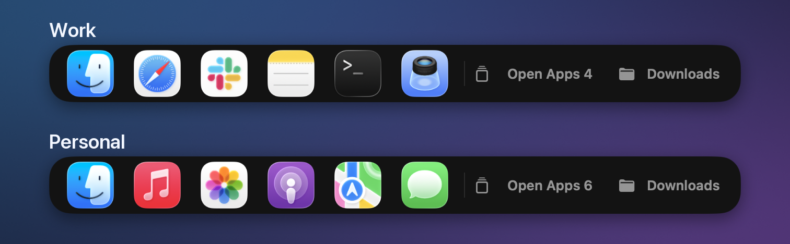
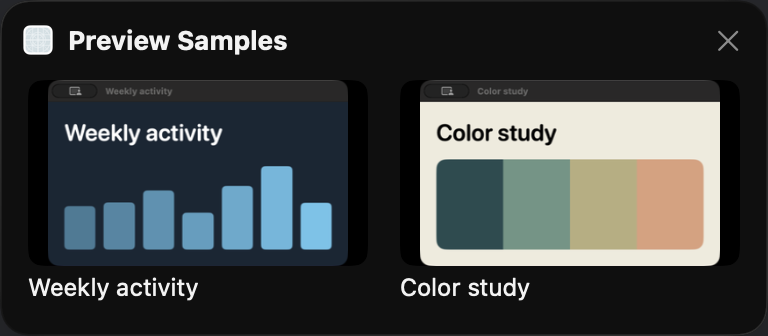
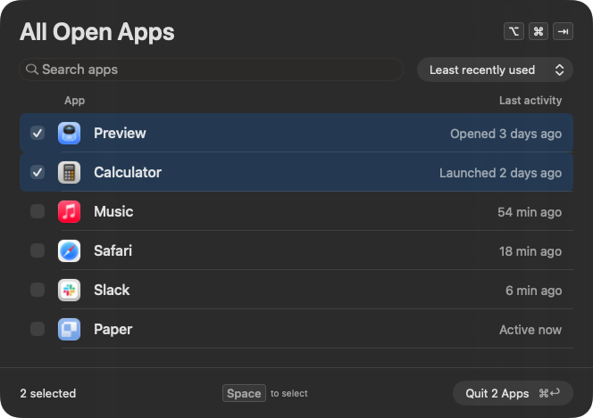

# Dock Profiles

Switch between a Work Dock and a Personal Dock without quitting your apps. Compact Dock keeps your pins in view, gathers other running apps into one stack, and leaves Downloads a click away.

**[Download for Mac](https://github.com/jgil325/dock-profiles-releases/releases/latest/download/Dock-Profiles.dmg)** · [Browse releases](https://github.com/jgil325/dock-profiles-releases/releases)

For Apple silicon and Intel Macs running macOS 14 or later. Compact Dock uses Apple’s Liquid Glass on macOS 26 and later.

## Get started

1. Download and open the disk image. Drag **Dock Profiles** into **Applications**, eject the disk image, then open the installed app. You can also install it in the Applications folder inside your home folder.
2. Click the Dock Profiles icon in the menu bar and choose **Compact Dock**. Your starting pins are saved under **Original**.
3. Open **Settings…** to add or reorder pins in **Work** and **Personal**, or create another profile. Choose a profile in the menu bar to switch layouts.

The download is locally signed. Apple hasn’t notarized it. If macOS blocks the first launch and you trust the download, try opening it once, then go to **System Settings → Privacy & Security → Open Anyway**. On a managed Mac, your IT team may need to approve it. [Apple’s first-launch guide](https://support.apple.com/en-us/102445)

## Switch apps and windows

**⌘Tab** switches among your running pins and recent apps when you enable **Use Profile App Switcher** in the menu bar. Hold **⌘** and tap **Tab** or point to an app, then release **⌘** to switch. Hold **Shift** to go backward or press **Esc** to cancel. In **Settings → Behavior**, choose how many other recent apps to show, from zero to five. The default is four.

Hover over a running pin to see its windows. Click a preview to bring that window forward, even if it was minimized. The preview cards follow each window’s proportions as you resize it.

[Watch the previews adjust as a sample window changes size](docs/screenshots/resizing-previews.gif)

## See what’s still open

Press **⌥⌘Tab** from any app to open **All Open Apps**. Sort by last use to find apps you haven’t touched in a while, or type a name to filter the list. Click rows or use **↑** and **↓** with **Space** to select apps. **⌘Return** sends a normal quit request to each selection, so an app can ask you to save. **Esc** or a click outside dismisses the list.

Dock Profiles tracks foreground use locally. When there’s a gap, it can show the app’s **Opened** date from Spotlight or its current **Launched** date. Hover over a time to see the full date. No Screen Time permission is needed. You can change the shortcut in **Settings → Behavior → All Open Apps**.

## Customize your Dock

In **Settings**, each profile has its own pins, theme, glass, tint, opacity, size, spacing and position. **Reserve space for Rectangle** keeps resized windows above the Dock. Type in the **Open Apps** or **Downloads** stack to search, or click the other stack to switch between them.

To mirror notification badges, use the profile switcher, or select windows by title, allow **Accessibility** in Settings. **Screen Recording** enables live window thumbnails. Thumbnails stay in memory, and capture stops when the preview closes.

## Share and update

Send the download link above, or choose **Updates → Copy Download Link** in Dock Profiles. The installed app checks for signed updates every five minutes while you’re logged in and keeps profiles on your Mac. Open **Updates** to check immediately or turn automatic updates off.

If you installed version 1.8.0 or earlier, quit it and install the current download once to join automatic updates.
